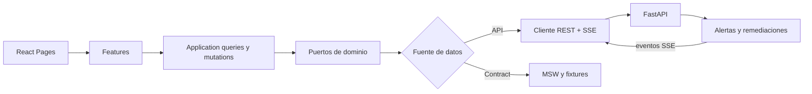

# Zikit Sentinel — Frontend

Dashboard operativo para visualizar alertas tempranas, reproducir corridas oficiales y seguir remediaciones autónomas controladas en tiempo real.

## Arquitectura



La interfaz separa dominio, aplicación e infraestructura. Los componentes consumen puertos tipados y no dependen directamente de HTTP, lo que permite usar el backend real o el contrato local sin cambiar la UI.

## Flujo de usuario

1. El operador abre el centro de operación y selecciona una corrida.
2. El frontend solicita un replay causal al backend.
3. La telemetría y las alertas aparecen progresivamente mediante SSE.
4. El operador revisa confianza, evidencia, anticipación y acción recomendada.
5. Si una alerta crítica permanece abierta, el panel muestra espera, decisión de Gemini, ejecución MCP y verificación.
6. El operador puede reconocer la alerta antes de la acción o descargar la auditoría CSV.
7. Si la recuperación falla, la interfaz muestra rollback y escalamiento.

## Tecnologías

| Área | Tecnología |
|---|---|
| Interfaz | React 19, TypeScript 5.9 |
| Construcción | Vite 7, pnpm |
| Datos remotos | TanStack Query |
| Contratos | Zod |
| Tiempo real | Server-Sent Events, `eventsource-parser` |
| Gráficas | Recharts |
| Animación e iconos | GSAP, Lucide React |
| Simulación local | Mock Service Worker |

## Instalación completa

Requisitos: Node.js 20.19 o superior, pnpm 10 y Python 3.12.

Los dos repositorios deben ser hermanos dentro de la misma carpeta:

```text
Zikit/
├── zikit-2026/
└── FrontEnd-HackSaltillo-main/
```

```bash
git clone git@github.com:Hydra115-code/zikit-2026.git zikit-2026
cd zikit-2026
python3.12 -m venv .venv
.venv/bin/pip install -e '.[ai,test]'
cp .env.example .env
# Agrega GEMINI_API_KEY en .env

cd ..
git clone git@github.com:Usualldude21/FrontEnd-HackSaltillo.git FrontEnd-HackSaltillo-main
cd FrontEnd-HackSaltillo-main
corepack enable
pnpm install --frozen-lockfile
```

## Demostración

```bash
pnpm demo:jury
```

El script localiza el backend compatible, crea una base temporal e inicia:

- Dashboard: `http://127.0.0.1:5173`
- Backend: `http://127.0.0.1:8000`
- Código de acceso de la demo: `1319`

Para usar otra ubicación o puertos:

```bash
SENTINEL_BACKEND_DIR=/ruta/al/backend \
SENTINEL_BACKEND_PORT=8001 \
SENTINEL_FRONTEND_PORT=5174 \
pnpm demo:jury
```

## Modos disponibles

```bash
pnpm dev:api       # backend real
pnpm dev:contract  # contrato local con MSW
pnpm typecheck
pnpm build
```

`VITE_API_BASE_URL` puede configurarse en `.env`; usa `/` para aprovechar el proxy local. Nunca coloques tokens o claves en variables `VITE_*`, porque Vite las expone al navegador.

## Secciones del dashboard

| Ruta | Función |
|---|---|
| `/operacion` | Estado general, alertas y remediación controlada |
| `/alertas` | Cola, filtros, evidencia y reconocimiento |
| `/incidentes` | Casos e historial causal |
| `/rendimiento` | Cobertura y desempeño del detector |
| `/replay` | Ejecución observable de corridas |

## Integración con el backend

El proxy de Vite agrega el token administrativo solo a las rutas protegidas de la demo. La API key de Gemini permanece en el `.env` del backend y nunca llega al navegador. Las actualizaciones de alertas y remediaciones se reciben por SSE con cursores reanudables.
